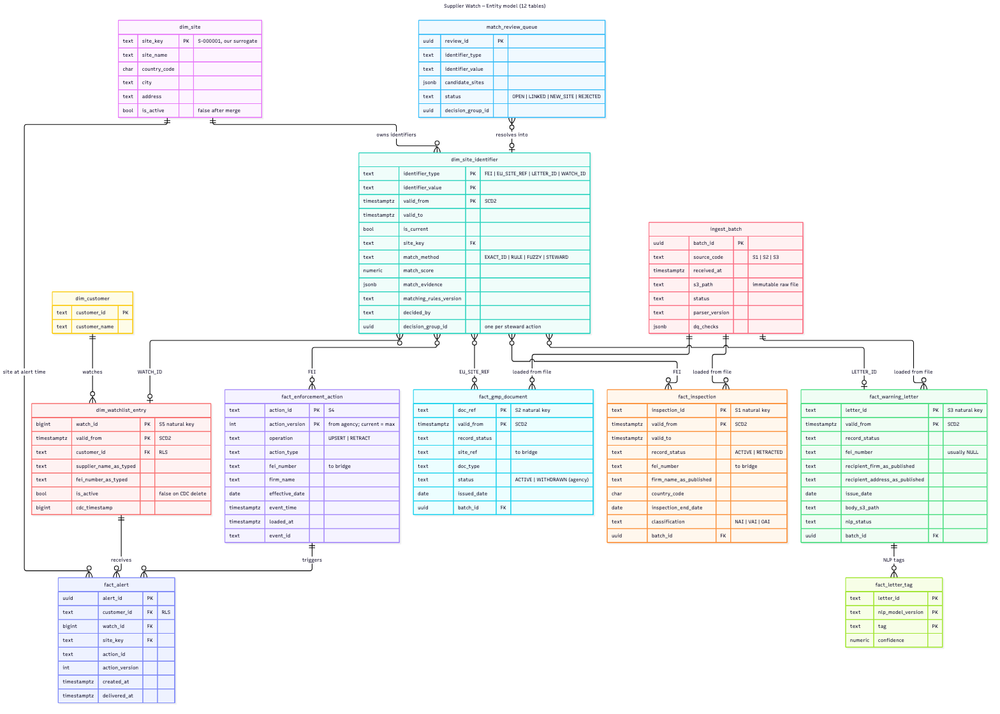
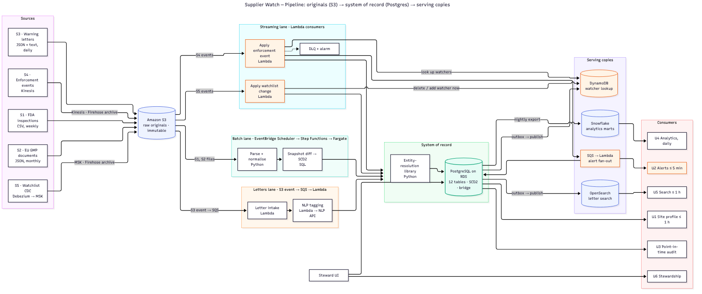

# Supplier Watch — Senior Data Engineer take-home

Submission document. Reference material (full data dictionary, full DDL, sample data, query output) is in the separate appendix; every file is also in the repository (`README.md`).

## Contents

1. Key decisions at a glance
2. Part A — Data model
3. Part B — Model rationale
4. Part C — Pipeline architecture
5. Part D — Pipeline rationale
6. Assumptions, AI usage, time spent

---

# Key decisions at a glance

One line per decision: what I chose, why, and what I rejected. The rest of the document is the detail behind each row.

| Decision | Why | Rejected alternative |
|------------------------------|--------------------------------------|------------------------|
| **Facts are stored per agency, keyed by the agency's own ID, as SCD Type 2 versions.** A correction is a new version; a retraction is a version marked `RETRACTED`. Nothing is overwritten. | Agencies silently correct and delete. U3 asks "what did we show on date X", which needs every version kept. One range filter answers it. | Overwrite in place and keep an audit log. Loses the ability to query the past directly. |
| **A site is a versioned opinion.** Facts never carry `site_key`; a bridge table maps each agency identifier to our site, with history. | Identity is a decision that changes (merges, splits, better rules). Changing a few bridge rows is cheap and reversible; rewriting millions of fact rows is neither. | `site_key` on every fact row. Simpler star; merges become mass updates with no history. |
| **PostgreSQL is the operational system of record; Snowflake is the analytical copy.** | The product has OLTP work (profile pages, per-event writes, merges, alert dedupe) and OLAP work (daily aggregates). Each gets the right engine. Postgres also enforces "one identifier → one site at a time". | Snowflake as the only store. Fine for analytics; unenforced constraints and app-facing latency/cost for the operational side. |
| **Every source lands in S3 first, unmodified, forever.** | The brief requires replay without re-fetching. Raw originals are the only way to re-run a parser or a matching rule later. | Load directly into the database. Cheaper today; no replay. |
| **S1/S2 snapshots are diffed against current rows in SQL** to produce INSERT / CORRECT / RETRACT. | The sources give no change flags. A set comparison is the natural way to find silent corrections and vanished rows, and it is a few hundred lines of testable SQL. | Treat snapshots as a stream of row events. Adds machinery, removes nothing. |
| **S4: current state = highest `version`; duplicates rejected by primary key; RETRACT stored as a tombstone.** | Order-safe by construction. A late v1 is stored but never current. Idempotency lives in the database, so Lambda retries are safe. | Consumer-side state or in-memory dedupe. Breaks on restart. |
| **Only S4 and S5 are streamed, through Lambda; no 24/7 cluster.** | Only U2 needs minutes. At 5k events/day a Flink cluster is a standing cost the brief asks us to justify, and we cannot. Both paths share one entity-resolution library. | Kappa (everything a stream) or Lambda architecture (two paths computing the same views). Neither fits weekly snapshots. |
| **Entity resolution is conservative: auto-link ≥ 0.95, human review 0.75–0.95, new site below.** Unit-number mismatch caps the score. | The brief ranks a wrong merge above a delay. A review queue costs steward time; a wrong merge costs customer trust. Unit I vs Unit II in the sample is exactly the trap. | Auto-link everything above a single threshold. Faster, and wrong in the one case the brief highlights. |
| **Alert fan-out reads a DynamoDB `site → watchers` lookup and writes `fact_alert` with a unique key.** | Millisecond lookup at 200 events/s without a Postgres connection in the hot path; the unique key makes the duplicate event a no-op. S5 deletes update the lookup in the same Lambda, so alerts stop immediately. | Query Postgres per event. Works at today's load; the first thing to fall over at 10x. |
| **NLP tagging is fully decoupled: letters are searchable immediately, tags arrive later via a rate-limited queue with retries and a DLQ.** | The API is slow (5–60 s), rate-limited (5 rps) and fails 2% of the time. None of that should block search. | Tag synchronously on intake. One slow call blocks a letter. |
| **A batch loads completely or not at all; a retraction rate above 2% quarantines it.** | A truncated file looks exactly like mass retractions. Keeping last week's data live is better than showing half a snapshot. | Load what parses. Produces partial, silently wrong states. |
| **Build order: raw landing on day 1, alerts by week 4, entity resolution and quality by week 6; defer S2, NLP, marts, steward UI.** | Append-only landing is cheap and starts history accumulating; alerts are what customers pay for; quality tooling improves a product that already exists. | Build the full model first. Nothing ships for six weeks. |


---

# Part A — Data model

## A.1 Entity diagram




## The idea in three sentences

1. **Facts are what agencies told us.** One `fact_` table per source. Rows are never overwritten:
   every correction is a new SCD2 version, every retraction is a row marked `RETRACTED`.
2. **A site is our opinion.** `dim_site` is just a label for "one physical plant". The agencies
   don't know our site IDs, so facts carry the *agency's* identifier (FEI, site_ref, ...).
3. **The bridge connects them.** `dim_site_identifier` maps each agency identifier to our site,
   as SCD2. Merging or splitting sites only changes bridge rows, never facts, and the old
   mapping is kept as history.

Everything a customer sees is a join: `fact → dim_site_identifier → dim_site`.

## Star or snowflake?

- **Core model (Postgres, system of record):** a star with one deliberate snowflake. Facts
  don't carry `site_key`; they carry the agency identifier, and the bridge resolves it.
  Reason: identity decisions change (merges, splits, better matching rules). Updating a few
  hundred bridge rows is cheap and keeps history; rewriting millions of fact rows is neither.
- **Analytics marts (Snowflake warehouse, U4):** a pure star. The nightly load flattens
  through the bridge and puts `site_key`, `country_code`, `quarter` directly on the fact.

## SCD2 convention used everywhere

| Column | Meaning |
|---|---|
| `valid_from` | When **our platform** started showing this version. Not the agency's date. |
| `valid_to` | When this version was replaced. `9999-12-31` while current. |
| `is_current` | `true` on the newest version. Same information as `valid_to`, kept for easy filtering. |

"What did we show on 2026-10-08?" = `WHERE valid_from <= '2026-10-08' AND valid_to > '2026-10-08'`.

## The 12 tables, one line each

| Table | Grain | Keyed by | History |
|---|---|---|---|
| `fact_inspection` | one FDA inspection result (S1) | `inspection_id` | SCD2 by snapshot diff |
| `fact_gmp_document` | one EU certificate or non-compliance report (S2) | `doc_ref` | SCD2 by snapshot diff |
| `fact_warning_letter` | one FDA warning letter (S3); text stays in S3 | `letter_id` | SCD2 |
| `fact_letter_tag` | one NLP tag on one letter, per model version | `letter_id, model, tag` | append-only |
| `fact_enforcement_action` | one version of one import alert / recall / debarment (S4) | `action_id, version` | current = highest version |
| `dim_site` | one physical plant, our own `site_key` | `site_key` | Type 1 |
| `dim_site_identifier` | **the bridge**: one agency identifier → one site, from/to | `type, value, valid_from` | SCD2 |
| `dim_customer` | one paying customer | `customer_id` | Type 1 |
| `dim_watchlist_entry` | one supplier a customer watches (S5) | `watch_id` | SCD2; `is_active` false on delete |
| `fact_alert` | one notification to one customer about one action version | unique `(watch, action, version)` | append-only |
| `match_review_queue` | one identifier a human must place | `review_id` | status changes |
| `ingest_batch` | one file received, with its S3 path and DQ results | `batch_id` | append-only |

Full column-by-column dictionary: appendix A. DDL for the five core tables: A.2 below; full DDL (35 statements, executed on PostgreSQL 17): appendix B.

## How each consumer is served (A.3 and U1–U6)

| Consumer | Path through the model |
|---|---|
| **U1** Site profile | `dim_site` → `dim_site_identifier` (current) → each fact table (current). Each row shows its agency ID and `batch_id`, so it is traceable to the file. |
| **U2** Alerts | new `fact_enforcement_action` version → `fei_number` → bridge → `site_key` → bridge rows of type `WATCH_ID` → `dim_watchlist_entry` (active) → distinct customers. Insert into `fact_alert`; the unique key blocks duplicates. |
| **U3** Audit | `fact_inspection WHERE valid_from <= :date AND valid_to > :date`. Same filter on the bridge gives "which site we *then* thought it belonged to". |
| **U4** Analytics | `fact_inspection` (current) → bridge → `site_key`; LEFT JOIN sites on cust_042's watchlist; GROUP BY country, quarter, on_watchlist. Flattened into a star in the warehouse nightly. |
| **U5** Search | `fact_warning_letter` + body from S3 + `fact_letter_tag` + site and country via bridge → one Elasticsearch document per letter. ES is a copy; rebuildable from here. |
| **U6** Stewardship | `match_review_queue` → human decision → close/insert bridge rows (all stamped with one `decision_group_id`, `decided_by`, `decision_reason`) → `dim_site.is_active`. Facts untouched; the alert lookup is rebuilt from the bridge so alerts follow. |

### A.3 a–d in one place

- **a. Canonical site and S1–S4 links.** `S-001` has bridge rows `FEI 3004521877`, `EU_SITE_REF LOC-118842`,
  `LETTER_ID WL-320-26-118`, `WATCH_ID 9912`. The two FDA inspections and the import alert reach it via the
  FEI; the EU report via the site_ref; the letter via its own letter_id. `FEI 3009876543` (Unit I, Visakhapatnam)
  is a separate `S-002`.
- **b. Corrected and retracted.** See the IN-2041187 and IN-2040551 tables above.
- **c. Merge with history.** Merge S-002 into S-001 = close S-002's bridge rows (`valid_to = now`), insert the same
  identifiers pointing at S-001, all stamped with one `decision_group_id` and the steward's ID and reason; set
  `S-002.is_active = false`. No fact row changes. "As of" queries before the merge still see S-002. A split finds
  every row carrying that `decision_group_id` and reverses it.
- **d. Tenant-private watchlists.** `customer_id` is on `dim_watchlist_entry` and `fact_alert` only, enforced
  by row-level security. Public tables carry no `customer_id`. A watch reaches a site through its own
  `WATCH_ID` bridge row; nothing public points back at a customer.


## A.2 Schema definitions: the five core tables

Full schema (35 statements, executed on PostgreSQL 17) in appendix B.

```sql
-- Part A.2 — DDL excerpt: the five core tables (PostgreSQL 15+).
-- Full schema (35 statements, executed on PostgreSQL 17): appendix B / 02_ddl.sql.
-- Convention: SCD2 tables are keyed by (natural_key, valid_from); valid_to = 'infinity' while current.

-- ============================================================================
-- DIMENSIONS
-- ============================================================================
CREATE TABLE dim_site (
    site_key      text PRIMARY KEY,                        -- 'S-000001', generated by us
    site_name     text NOT NULL,
    country_code  char(2),
    city          text,
    address       text,
    is_active     boolean NOT NULL DEFAULT true,           -- false once merged into another site
    created_at    timestamptz NOT NULL DEFAULT now()
);
CREATE INDEX dim_site_name_trgm    ON dim_site USING gin (site_name gin_trgm_ops);
CREATE INDEX dim_site_address_trgm ON dim_site USING gin (address gin_trgm_ops);
CREATE INDEX dim_site_block        ON dim_site (country_code, city);     -- blocking key for matching

-- The bridge: agency identifier -> our site, as SCD2.
-- Steward actions (merge, split, link, unlink) are recorded on the rows they open/close:
-- every row touched by one action shares a decision_group_id, so a split can find and reverse a merge.
CREATE TABLE dim_site_identifier (
    identifier_type         text NOT NULL CHECK (identifier_type IN ('FEI','EU_SITE_REF','LETTER_ID','WATCH_ID')),
    identifier_value        text NOT NULL,
    valid_from              timestamptz NOT NULL DEFAULT now(),
    valid_to                timestamptz NOT NULL DEFAULT 'infinity',
    is_current              boolean NOT NULL DEFAULT true,
    site_key                text NOT NULL REFERENCES dim_site,
    match_method            text NOT NULL CHECK (match_method IN ('EXACT_ID','RULE','FUZZY','STEWARD')),
    match_score             numeric(4,3),
    match_evidence          jsonb,
    matching_rules_version  text NOT NULL,
    decided_by              text NOT NULL,                 -- steward user id, or 'system:er-v3'
    decision_reason         text,                          -- free text; NULL for automatic matches
    decision_group_id       uuid,                          -- shared by all rows one steward action touched
    PRIMARY KEY (identifier_type, identifier_value, valid_from),
    -- one identifier belongs to exactly one site at any instant
    EXCLUDE USING gist (identifier_type WITH =, identifier_value WITH =, tstzrange(valid_from, valid_to) WITH &&)
);
CREATE INDEX dim_site_identifier_current_by_id   ON dim_site_identifier (identifier_type, identifier_value) WHERE is_current;
CREATE INDEX dim_site_identifier_current_by_site ON dim_site_identifier (site_key) WHERE is_current;

-- S1: FDA inspection classifications. Weekly full snapshot; versions come from diffing snapshots.
CREATE TABLE fact_inspection (
    inspection_id                     text NOT NULL,
    valid_from                        timestamptz NOT NULL,
    valid_to                          timestamptz NOT NULL DEFAULT 'infinity',
    is_current                        boolean NOT NULL DEFAULT true,
    record_status                     text NOT NULL CHECK (record_status IN ('ACTIVE','RETRACTED')),
    batch_id                          uuid NOT NULL REFERENCES ingest_batch,
    fei_number                        text NOT NULL,
    firm_name_as_published            text,
    city                              text,
    country_code                      char(2),
    inspection_end_date               date,
    inspection_end_date_as_published  text,
    classification                    text CHECK (classification IN ('NAI','VAI','OAI')),
    product_type                      text,
    published_date                    date,
    PRIMARY KEY (inspection_id, valid_from),
    EXCLUDE USING gist (inspection_id WITH =, tstzrange(valid_from, valid_to) WITH &&)
);
CREATE INDEX fact_inspection_current_by_fei ON fact_inspection (fei_number) WHERE is_current;
CREATE INDEX fact_inspection_by_end_date    ON fact_inspection (inspection_end_date);

-- S4: Enforcement actions. Versioned by the agency; current state = highest action_version.
CREATE TABLE fact_enforcement_action (
    action_id       text NOT NULL,
    action_version  int  NOT NULL,
    event_id        text NOT NULL,                         -- traceability to the S3 event archive
    operation       text NOT NULL CHECK (operation IN ('UPSERT','RETRACT')),
    action_type     text,
    agency          text,
    fei_number      text,                                  -- NULL on a bare RETRACT
    firm_name       text,                                  -- v1 'firm' and v2 'firm_name' both land here
    country_code    char(2),
    product_codes   jsonb,                                 -- v2 only
    effective_date  date,
    event_time      timestamptz NOT NULL,
    loaded_at       timestamptz NOT NULL DEFAULT now(),
    PRIMARY KEY (action_id, action_version)
);
CREATE INDEX fact_enforcement_action_by_fei ON fact_enforcement_action (fei_number);

CREATE TABLE fact_alert (
    alert_id        uuid PRIMARY KEY,
    customer_id     text   NOT NULL REFERENCES dim_customer,
    watch_id        bigint NOT NULL,
    site_key        text   NOT NULL REFERENCES dim_site,
    action_id       text   NOT NULL,
    action_version  int    NOT NULL,
    created_at      timestamptz NOT NULL DEFAULT now(),
    delivered_at    timestamptz,
    UNIQUE (watch_id, action_id, action_version)           -- idempotent fan-out
);
```

## A.4 Queries for U2, U3, U4

Executed against the brief's sample data; actual output in appendix D.

```sql
-- Part A.4 — Queries for U2, U3, U4 (PostgreSQL)
-- Each query is followed by the expected result against the sample data in the brief.

-- ============================================================================
-- U2  "Which customers must be alerted about IA-66-40-0098?"
-- ============================================================================
-- Path: current version of the action → its FEI → bridge → our site → bridge rows of type
-- WATCH_ID on that site → active watchlist entries → distinct customers.
-- "New or changed" includes a RETRACT: a customer who was told about a recall must also be told
-- it was withdrawn.

WITH action AS (
    SELECT action_id, action_version, operation, fei_number
    FROM   v_enforcement_action_current
    WHERE  action_id = 'IA-66-40-0098'
),
site AS (                                             -- which of OUR factories is this?
    SELECT a.action_id, a.action_version, a.operation, b.site_key
    FROM   action a
    JOIN   dim_site_identifier b
           ON  b.identifier_type  = 'FEI'
           AND b.identifier_value = a.fei_number
           AND b.is_current
),
watchers AS (                                         -- who is watching that factory right now?
    SELECT s.action_id, s.action_version, s.site_key, w.watch_id, w.customer_id
    FROM   site s
    JOIN   dim_site_identifier bw
           ON  bw.site_key        = s.site_key
           AND bw.identifier_type = 'WATCH_ID'
           AND bw.is_current
    JOIN   dim_watchlist_entry w
           ON  w.watch_id   = bw.identifier_value::bigint
           AND w.is_current
           AND w.is_active                            -- a CDC delete flips this, stopping alerts
)
SELECT DISTINCT customer_id
FROM   watchers;

-- Expected (sample data): cust_042  (via watch 9912 → S-001 ← FEI 3004521877)

-- The same CTEs drive the alert fan-out. ON CONFLICT makes a duplicate event a no-op (U2 idempotency):
--
-- INSERT INTO fact_alert (alert_id, customer_id, watch_id, site_key, action_id, action_version)
-- SELECT gen_random_uuid(), customer_id, watch_id, site_key, action_id, action_version
-- FROM   watchers
-- ON CONFLICT (watch_id, action_id, action_version) DO NOTHING;


-- ============================================================================
-- U3  "What was the classification of IN-2041187 as we showed it on 2026-10-08?"
-- ============================================================================
-- Pick the version whose validity window contains the end of that day.
-- Returns no row if we had not shown the inspection yet on that date (correct: we knew nothing).

SELECT inspection_id,
       classification,
       record_status,
       valid_from,
       valid_to,
       batch_id                                       -- → ingest_batch.s3_path: the exact file we showed
FROM   fact_inspection
WHERE  inspection_id = 'IN-2041187'
  AND  valid_from <= '2026-10-08 23:59:59+00'
  AND  valid_to   >  '2026-10-08 23:59:59+00';

-- Expected: classification = 'VAI'  (the 10-05 snapshot version; the OAI correction only became
--           valid on 10-12). Running the same query for 2026-10-13 returns 'OAI'.

-- Companion: which factory did we say it belonged to on that day? Same filter on the bridge.
SELECT b.site_key, s.site_name, b.match_method
FROM   fact_inspection i
JOIN   dim_site_identifier b
       ON  b.identifier_type  = 'FEI'
       AND b.identifier_value = i.fei_number
       AND b.valid_from <= '2026-10-08 23:59:59+00'
       AND b.valid_to   >  '2026-10-08 23:59:59+00'
JOIN   dim_site s ON s.site_key = b.site_key
WHERE  i.inspection_id = 'IN-2041187'
  AND  i.valid_from <= '2026-10-08 23:59:59+00'
  AND  i.valid_to   >  '2026-10-08 23:59:59+00';


-- ============================================================================
-- U4  "OAI rate by country and quarter for the last 3 years,
--      for sites on cust_042's watchlist versus all sites."
-- ============================================================================
-- Analytics uses the CURRENT version of each inspection (what we believe today), not as-of.
-- Retracted inspections are excluded by the view.

WITH insp AS (
    SELECT i.inspection_id,
           i.country_code,
           date_trunc('quarter', i.inspection_end_date)::date AS quarter,
           (i.classification = 'OAI')::int                     AS is_oai,
           b.site_key
    FROM   v_inspection_current i
    JOIN   dim_site_identifier b
           ON  b.identifier_type  = 'FEI'
           AND b.identifier_value = i.fei_number
           AND b.is_current
    WHERE  i.inspection_end_date >= date_trunc('quarter', current_date) - interval '3 years'
),
watched_sites AS (                                    -- factories on cust_042's list today
    SELECT DISTINCT bw.site_key
    FROM   dim_watchlist_entry w
    JOIN   dim_site_identifier bw
           ON  bw.identifier_type  = 'WATCH_ID'
           AND bw.identifier_value = w.watch_id::text
           AND bw.is_current
    WHERE  w.customer_id = 'cust_042'
      AND  w.is_current
      AND  w.is_active
)
SELECT i.country_code,
       i.quarter,
       count(*)                                                        AS inspections_all,
       round(100.0 * avg(i.is_oai), 1)                                 AS oai_rate_all_pct,
       count(*)        FILTER (WHERE ws.site_key IS NOT NULL)          AS inspections_watchlist,
       round(100.0 * avg(i.is_oai) FILTER (WHERE ws.site_key IS NOT NULL), 1)
                                                                       AS oai_rate_watchlist_pct
FROM   insp i
LEFT JOIN watched_sites ws ON ws.site_key = i.site_key
GROUP  BY i.country_code, i.quarter
ORDER  BY i.country_code, i.quarter;

-- Expected shape (sample data, current state after the 10-12 snapshot):
--   country  quarter     inspections_all  oai_rate_all  inspections_watchlist  oai_rate_watchlist
--   IN       2026-07-01  2                50.0          2                      50.0
--   (IN-2041187 = OAI after correction, IN-2039902 = NAI; both on S-001 which cust_042 watches;
--    IN-2040551 is retracted and excluded)
--
-- In production this query runs against the nightly Snowflake star, where site_key, country and
-- quarter are already flattened onto the fact row and the bridge join disappears.
```

---

# Part B — Model rationale

## 1. Stores: one record, purpose-built copies

**Decision.** PostgreSQL holds the model (the system of record). S3 holds the raw originals. DynamoDB, OpenSearch and Snowflake are copies, each serving one consumer, each rebuildable from Postgres and S3.

**Why.** The product has two kinds of work and they need different engines:

| Workload | From the brief | Shape | Engine |
|---|---|---|---|
| Operational (OLTP) | Site page (U1), alert within 5 min (U2), watch delete stops alerts now (S5), merge/split (U6), "did we already alert this customer?" | Few rows at a time, thousands of times a day, milliseconds, rules that must hold | PostgreSQL on RDS |
| Analytical (OLAP) | OAI rate by country and quarter over 15 years (U4) | Millions of rows, daily, seconds are fine | Snowflake |

Postgres is the operational database of the product, the same role the customer app's own Postgres plays for that app (S5 is literally that database replicated out). Snowflake is the nightly analytical copy. S3 holds the messy originals and is never queried by the product.

| Store | Holds | Because |
|---|---|---|
| S3 | Every file and event as received, immutable | Replay without re-fetching (brief requirement) |
| PostgreSQL | 12 tables: SCD2 facts, versioned bridge, sites, watchlists, alerts, review queue, lineage | Enforced constraints, per-event writes, point-in-time queries, row-level security, millisecond reads |
| DynamoDB | `site_key → [watch_id, customer_id]` | Alert fan-out in milliseconds at 200 events/s, no DB connection in the hot path |
| OpenSearch | One document per letter with tags and facets | Full-text search (U5) |
| Snowflake | Nightly flattened star | Aggregates (U4) |

**Trade-off.** One more database than a Snowflake-only design. Accepted because the brief ranks a wrong merge as the worst outcome, and "the database refuses the write" beats "a test would have caught it". Engines (Flink, Spark) are a separate question from stores; at today's volumes they add a 24/7 cost without changing the design, so processing is SQL, Python on Fargate, and Lambda. They are the upgrade path at 10x.

## 2. History and time

**Decision.** Two kinds of time, never mixed. Agency time (inspection date, issue date) is stored as published. Platform time (`valid_from` / `valid_to`) records when *we* showed each version.

| Table | Versioning | Why |
|---|---|---|
| S1, S2, S3 facts | SCD2 by snapshot diff: INSERT / CORRECT / RETRACT | Sources give no change flags; we infer them. Retractions keep the row, marked `RETRACTED` |
| S4 enforcement actions | Agency `version` number; current = highest | Order-safe without closing rows; a late v1 is stored but never current |
| Bridge, watchlists | SCD2 | "Which site did we *then* think this was" and "what were you watching when" |
| `dim_site` attributes, all serving copies | Overwritten (Type 1) | Display names changing is not history customers care about; copies are rebuilt |

U3 becomes `WHERE valid_from <= :date AND valid_to > :date`. Verified: IN-2041187 returns VAI for 2026-10-08 and OAI for 2026-10-13.

**Trade-off.** Not fully bitemporal: agency time is a plain column, not a second validity range. No consumer in U1–U6 asks a question that needs more.

## 3. Site identity and entity resolution

**Decision.** An agency's own identifier is authoritative within that agency. Everything across agencies is a scored, explainable, reversible decision made by one Python library used by batch and stream alike.

| Step | What happens | The sample case |
|---|---|---|
| Normalise | lowercase, strip punctuation, `pvt→private`, `unit ii→unit 2`, transliterate, ISO country, tokenise address | "Acme Pharma Pvt. Ltd." and "ACME PHARMACEUTICALS PRIVATE LIMITED - UNIT II" become comparable |
| Block | same country **and** (postcode **or** address token **or** city) | FDA says Hyderabad, EU says Sangareddy; the shared token `pashamylaram` / `plot 14` brings them together. City alone would miss it |
| Score | address-token overlap + core-name similarity + postcode; **unit designator mismatch caps the score at 0.6** | Keeps Unit I (Visakhapatnam) and Unit II (Hyderabad) apart despite near-identical names |
| Decide | same agency ID → link · ≥ 0.95 → auto-link · 0.75–0.95 → review queue · < 0.75 → new site | The warning letter (no FEI, address matches the EU record) scores 0.91 → a steward confirms it |

Every bridge row records method, score, evidence and the rules version, so a steward can see *why*, and a new rules version can run in shadow and be compared before promotion. A customer confirming a pending watch match is recorded as a steward decision for that watch.

**When a match is wrong.** A steward SPLITs: close the wrong bridge rows, open correct ones, all stamped with one `decision_group_id`. Facts: untouched. History: intact (point-in-time queries still show what we showed). Copies: re-published for both sites. Alerts: already-sent rows stay as history; affected customers get a correction notice and the newly separated site's watchers get a catch-up alert, both as new idempotent `fact_alert` rows.

**Trade-off.** More items reach humans than an aggressive matcher would send. That is the point: the brief says a wrong merge is worse than a delay.

## 4. Normalisation vs denormalisation

**Rule.** Normalise where **decisions** live; denormalise where **evidence** lives.

| Normalised | Why |
|---|---|
| `dim_site` ← bridge ← facts (the one snowflake) | Identity changes; a small SCD2 table makes merges cheap and historical |
| `dim_customer`, `fact_letter_tag` | Standard 1:N; tags keep every model version |

| Denormalised | Why |
|---|---|
| Facts keep the agency's firm name and address verbatim (no `dim_firm`) | The text *is* the evidence; a firm dimension is a second entity-resolution problem no consumer asked for |
| `dim_site` carries a copy of name/address | Fast profile header and matching candidates; recomputed on reprocess |
| `fact_alert` carries `customer_id` and `site_key` | Row-level security needs the tenant on the row; the site must be the one *at alert time*, which a later split must not rewrite |

Who pays for the snowflake: U1 (one extra join, hidden behind a view). Who never sees it: U2, U4, U5, whose copies are flattened at publish time. Who it exists for: U6.

## 5. Alternative considered and rejected

**Snowflake as the system of record**: S3 → Snowpipe → staging → dbt snapshots → marts, with DynamoDB for watchers and alerts. All on the stated stack, one database fewer. Rejected for three reasons specific to this brief: (1) primary keys and the one-identifier-one-site rule are declared but **not enforced** in a warehouse, so a bad matching run corrupts the bridge silently; (2) the customer app reads the model for U1, and a warehouse serving sub-second reads must stay running, a standing cost the brief asks us to justify; (3) S4/S5 are thousands of small per-event upserts, which a columnar engine handles poorly without extra components. Not a reason: transactions (Snowflake has them).

**What would make me revisit it.** If the app stopped reading the model directly (its own cache or DynamoDB for profiles) and the stream path wrote only to DynamoDB, Postgres would be serving nobody Snowflake could not, and the warehouse should become the record. Same DDL; constraints become tests.


---

# Part C — Pipeline architecture

## Diagram



Read left to right: **originals → three processing lanes → system of record → serving copies → consumers.** Orange is the 5-minute alert path; green is the system of record.

## Components and triggers

| Stage | Component | Trigger | Why this choice |
|---|---|---|---|
| Raw landing | Amazon S3, versioned, one object per arrival, lifecycle to Glacier after a year | Batch files land directly; stream events via Kinesis Firehose | Immutable originals for replay, same answer for batch and stream |
| Batch fetch (S1, S2) | Step Functions state machine per source running Fargate Python tasks | EventBridge Scheduler: Monday 06:00 (S1), 1st of month (S2) | Pay-per-run; no 24/7 Airflow to host for a 4-person team |
| Parse + normalise | Fargate task → parquet in `s3://staged/` → `COPY` into a Postgres staging schema | Next step in the state machine | Parsing is where the quirks live (dates, country codes, duplicates); isolating it makes it replayable on its own |
| Snapshot diff | SQL in Postgres, one transaction per batch | Next step | A set comparison of staging vs current is a few hundred lines of testable SQL |
| Entity resolution | Python library (`supplierwatch.er`); candidate search via Postgres `pg_trgm` | Called by batch tasks and by the stream Lambdas | One code path, one set of thresholds, one evidence format |
| Letters (S3) | S3 `ObjectCreated` → SQS → Lambda "letter"; Lambda "nlp" on its own queue with reserved concurrency 5, retry with backoff, DLQ after 5 attempts | Event-driven | Letter searchable in minutes; the slow, rate-limited, flaky NLP API is fully decoupled |
| Enforcement stream (S4) | Kinesis Data Stream (partition key `action_id`) → Lambda "s4-apply" (batch 100, bisect on error) | Stream | One action's events stay in order on one shard; Lambda scales with bursts and costs nothing idle |
| Watchlist CDC (S5) | Debezium (app team) → MSK → Lambda "s5-apply" | Stream | Deletes must stop alerts immediately, so S5 cannot be batch |
| Hot lookup | DynamoDB `site_watchers` (PK `site_key`, SK `watch_id`, attr `customer_id`) | Written by the publish Lambda from a Postgres outbox, and directly by "s5-apply" | Millisecond fan-out without a Postgres connection in the hot path |
| Alerting | SQS → Lambda "notify" → `fact_alert` (`ON CONFLICT DO NOTHING`) → email / webhook | Queue | Idempotent at the database; retries are safe |
| Search | Amazon OpenSearch, smallest production domain | Updated by "letter", "nlp" and the publish Lambda | The only 24/7 component besides Postgres; justified by U5 |
| Analytics | Nightly Fargate task: Postgres → parquet → Snowflake `COPY`; marts rebuilt | EventBridge 02:00 | Daily is the stated freshness; a full rebuild is simplest |
| Stewardship | Small internal app (or admin SQL to start) over the review queue and the bridge | On demand | Every write stamps `decision_group_id`, `decided_by`, `decision_reason` |
| Monitoring | CloudWatch alarms on every queue, DLQ and Lambda error rate; batch DQ results stored on `ingest_batch` | Always | See Part D §5 |

## Walkthroughs

### a. The S1 weekly snapshot (corrections and retractions)

1. Monday 06:00: the S1 state machine downloads the CSV to `s3://raw/s1/received_date=2026-10-12/`. An `ingest_batch` row is created (`RECEIVED`).
2. Parse: dates normalised per the S1 rule (original kept), country names → ISO-2, in-file duplicates dropped. Rows `COPY`'d into staging. Data-quality checks run (row count vs last week, parse failures, null FEI rate, duplicate keys, retraction rate). Any failure → `QUARANTINED`, nothing loaded, on-call paged, last week's data stays live.
3. Diff, one transaction:
   - in staging, not in current → **INSERT** version (`valid_from = received_at`)
   - in both, business columns differ → close current, **CORRECT** version. IN-2041187 goes VAI → OAI here
   - in current, missing from staging → close current, **RETRACTED** version. IN-2040551 goes here
4. ER: each FEI not yet in the bridge gets a new site and an `EXACT_ID` row. Known FEIs are untouched.
5. Outbox rows for changed sites → publish Lambda refreshes OpenSearch, DynamoDB, marts. Batch `LOADED`.

### b. The four S4 events, in arrival order

| # | Event | What "s4-apply" does |
|---|---|---|
| 1 | `e-88f1` v1 UPSERT (schema v1) | v1 parser maps `firm` → `firm_name`. Insert `(IA-66-40-0098, 1)`. Current = v1. FEI 3004521877 → DynamoDB → watch 9912 (cust_042) → alert enqueued |
| 2 | `e-91c3` v2 UPSERT (schema v2) | v2 parser. Insert `(IA-66-40-0098, 2)`. Current = v2, differs from v1 → "changed action" alert to the same watchers |
| 3 | `e-88f1` again | Insert hits PK `(IA-66-40-0098, 1)` → no-op. No alert; even if enqueued, `fact_alert`'s unique key would drop it |
| 4 | `e-93aa` v3 RETRACT for `RC-2026-1187` | Insert `(RC-2026-1187, 3, RETRACT)`. Never seen v1/v2: the row is a tombstone, so a late v1 is stored but never current. No FEI → no site → no alert; a review item is opened |

Any other arrival order gives the same end state: current is always the highest version and the PK rejects repeats.

### c. A new S3 warning letter

1. `WL-320-26-118.json` + text land in S3. `ObjectCreated` → SQS → Lambda "letter".
2. Metadata → `fact_warning_letter` (`nlp_status = PENDING`, `fei_number` null); body → `s3://raw/s3/…/WL-320-26-118.txt`.
3. ER on recipient name + address: tokens `plot 14`, `pashamylaram` block against S-001; address similarity 0.93, name 0.85, no unit mismatch → 0.91 → **review band**. Review item opened. The letter is indexed in OpenSearch immediately with `site_key = null`, so it is already findable by text (U5 met).
4. Message to the NLP queue. Lambda "nlp" (≤ 5 concurrent → ≤ 5 rps) calls the API; on the 2% failure, backoff and retry up to 5 times, then DLQ + metric. On success: `fact_letter_tag` rows, `nlp_status = DONE`, OpenSearch document patched with tags.
5. A steward confirms S-001 (the EU record has the same plot). Bridge row `LETTER_ID → S-001` (`STEWARD`, `decision_group_id`). Outbox → publish: the document gets `site_key`; the profile page shows the letter.

### d. An S5 watchlist delete

1. The customer removes SUP-0071. Debezium emits `{"op":"d", "before": {"watch_id": 9912, "customer_id": "cust_042", …}, "ts_ms": …}`.
2. Lambda "s5-apply": if `ts_ms` is older than the applied `cdc_timestamp`, ignore. Otherwise close the current version and open one with `is_active = false`.
3. **Same invocation:** `DeleteItem` on DynamoDB `site_watchers (S-001, 9912)`. From this moment any S4 event for S-001 finds no watcher for cust_042. This is the "immediately" in the brief: it does not wait for the outbox.
4. The bridge row `WATCH_ID 9912 → S-001` is closed (`valid_to = now`) so history shows when the customer stopped watching. Public data is untouched.


---

# Part D — Pipeline rationale

## 1. Batch and streaming: split by source, unified by store

**Decision.** S1, S2, S3 are batch. S4, S5 are streamed. Both paths write the same Postgres tables through the same entity-resolution library.

**Why.** Only U2 needs minutes. The streaming consumer therefore does four things and no more: dedupe, apply a version, look up watchers, enqueue an alert. It never parses CSVs or diffs snapshots. A consumer that small can be read in one sitting at 3 a.m.

**What this is not.** Not Kappa: snapshots are sets, not events; detecting a vanished row means comparing two complete files, and forcing a CSV through a stream adds machinery and removes nothing. Not Lambda architecture: the two paths handle *different* sources and never compute the same result twice, so there is no reconciliation and no duplicated logic. What it is: a layered store (raw S3 → cleaned Postgres → purpose-built copies), a hub-and-link identity model (Data Vault style), Kimball stars in the marts, idempotent consumers, and a transactional outbox for publishing copies.

## 2. Correctness under duplicates, disorder, late data, schema change

| Hazard | Mechanism | Where |
|---|---|---|
| Duplicate S4 event | `INSERT … ON CONFLICT DO NOTHING` on PK `(action_id, version)`; same on `fact_alert (watch, action, version)` | Database, not consumer memory, so retries are safe |
| Out-of-order versions | Current = highest `version`; a late v1 is stored, never served. Kinesis partitioned by `action_id` | Model + stream config |
| RETRACT for an unseen action | Stored as a tombstone; a later lower version cannot become current. No FEI → no alert, review item opened | `s4-apply` |
| Late S1 correction (2024 row fixed in 2026) | Diff is set-based; it appears as a CORRECT with `valid_from = 2026`. U3 for 2025 still returns the old value | Snapshot diff |
| Duplicates inside one S2 file | De-duplicated on `(doc_ref, content hash)` before the diff | Parse step |
| Out-of-order S5 CDC | `ts_ms` guard: older events ignored | `s5-apply` |
| S4 schema v1 → v2 | Parser keyed on `schema_version`; unknown version → DLQ + alarm, never best-effort | `s4-apply` |
| Ambiguous dates | Per-source rule; raw string kept, so a rule change is a re-parse, not a re-fetch | Parse step |

## 3. Reprocessing and backfill

**15-year history.** Load the historical snapshots oldest → newest through the same diff pipeline, with `valid_from` set to each snapshot's original date. This reconstructs the version history as if we had always been running, which is the only way U3 can answer questions about dates before go-live. Source order: S1 first (FEI is the most reliable identifier, so sites are born from it), then S2, then S3. Same code as the weekly job, bigger Fargate tasks.

**Entity-resolution rule change.** Never rewrite the bridge in place. Run the new rules into a shadow table with its own `matching_rules_version`; diff against current (which identifiers move, which sites merge or split); review the diff (every change below a size threshold, sampled above it); promote in one transaction under one `decision_group_id`. Old rows stay as history; if the new rules are worse, a split by that group ID reverses them. Facts are never touched.

**Parser change.** Re-run parse + diff from S3 into staging, compare, promote the same way. `ingest_batch.parser_version` tells the reprocess apart from the original load.

## 4. Data quality

| Layer | Checks | On failure |
|---|---|---|
| Raw | File present, non-empty, parseable, expected columns | Batch `FAILED`; page on-call; nothing downstream runs |
| Parse | Date-parse failures < 0.5%; country mapping failures = 0; duplicate keys; null-FEI rate vs baseline | `QUARANTINED`; last good load stays live; rejects written to a side table |
| Diff | Row count ±20% of last snapshot; **retraction rate < 2%**; classification mix vs baseline | `QUARANTINED`. A 30% retraction rate is a truncated file, not 75k real retractions. The single most important check |
| ER | New-site rate, auto-link rate, review-queue growth vs rolling baseline | Warn; large shifts usually mean a normalisation bug |
| Stream | Unknown schema; event with neither FEI nor known action; Lambda error rate | DLQ + alarm; the stream keeps flowing |
| Serving | Hourly: DynamoDB watcher count = active watch bridge rows | Rebuild from Postgres; alarm on repeat |

**Rule.** A batch loads completely or not at all. "Not at all" leaves last week's data live, which is always better than half a snapshot.

## 5. Monitoring: the first five signals

1. **Alert latency** p95 (`delivered_at − event_time`) against the 5-minute SLO.
2. **Undelivered alerts** older than 5 minutes. Catches a dead notifier when everything upstream is green.
3. **Snapshot diff profile** per S1/S2 run (inserts, corrections, retractions, row count) against an 8-week baseline. **This is how you know the S1 job "succeeded" but loaded bad data**: zero corrections for three weeks, or 12k retractions in one, is wrong even when every step exits 0. Plotted, so a human sees the shape.
4. **Stream health**: Kinesis iterator age (falling behind?) and DLQ depth (dropping silently?).
5. **Review-queue size and age**: growth faster than stewards clear it means thresholds or normalisation have drifted, and facts are sitting on no profile page.

Plus a nightly reconciliation: current facts per site in Postgres vs documents per site in OpenSearch and Snowflake.

## 6. What breaks first at 10x

| Pressure | Breaks | Change |
|---|---|---|
| 25 agencies, each a different format | One hand-written parser per source | Parser plugin interface (`fetch / parse / natural_key / dates`) and a `dim_agency` table with parser config. **First thing I would change**, before any infrastructure |
| 1M sites | Trigram candidate search over all of `dim_site` | Candidate generation in OpenSearch (already running); batch ER on Spark with Splink for backfills |
| 2k events/s bursts | Per-event Postgres writes from Lambda | Micro-batching (already 100/invocation), RDS Proxy; then Flink doing dedupe and version compare before Postgres |
| 400 customers, 250k watches | Fan-out per event | DynamoDB handles it; batch notifications per customer per minute |
| Nightly full export | Gets long | Incremental export on `valid_from > last run` |

## 7. Six weeks with this team

| Weeks | Build | Reason |
|---|---|---|
| 1–2 | Raw landing for all five sources; Postgres model; S1 parse + diff + SCD2; FEI-based sites | Landing is append-only and cheap, and history starts accumulating from day one |
| 3–4 | S4 stream apply, DynamoDB watchers, alerts end to end; S5 apply with immediate delete; basic U1 profile | Alerts are what customers pay for |
| 5–6 | ER library with the three bands and a bare review table; S3 letters into Postgres and OpenSearch; quarantine + the five monitors | Quality tooling improves a product that already exists |

**Deliberately deferred:** S2 (monthly; week 7 loses nothing), NLP tagging (search works without it), Snowflake marts (U4 can be served from Postgres for 40 customers), a steward UI (a table and two SQL functions suffice for one steward), geocoding, the 15-year backfill (needs a stable pipeline; raw landing from day one means we lose nothing by waiting).


---

# Assumptions, AI usage, time spent

## Assumptions

Where the brief was silent or ambiguous, I assumed the following.

1. **S1 dates** parse as ISO first, otherwise `MM/DD/YYYY`; `08/02/2026` is 2 August 2026. The original string is kept so the rule can change without re-fetching.
2. **S1/S2 snapshots are complete**: a row missing from the new snapshot is a retraction. A retraction rate above 2% is treated as a bad file and quarantined instead.
3. **S2 `WITHDRAWN`** is a correction (new version), not a retraction: the document still exists. In-file duplicates are identical copies and are dropped before diffing.
4. **S4 `version`** is monotonically increasing per `action_id` and is the authoritative order. A RETRACT for an action never seen is stored as a tombstone and queued for review, not alerted (it carries no FEI). An unknown `schema_version` goes to a dead-letter queue rather than being parsed on a best-effort basis.
5. **S5 CDC** is produced by the customer-app team (Debezium on their PostgreSQL); we consume a topic and never connect to their database.
6. **Within one agency the agency's ID is authoritative**: same FEI = same site. Cross-agency matching auto-links at ≥ 0.95, sends 0.75–0.95 to a human, creates a new site below 0.75. Thresholds are a starting point to be tuned on steward decisions. At least one part-time steward is available.
7. **"New or changed" enforcement action includes a RETRACT**: customers told about an action are told when it is withdrawn.
8. **The customer app reads site profiles from the model** via an API, which is why the model needs an OLTP store (Part B §5 states when that would change).
9. **15-year historical snapshots can be obtained** for S1 and S2. If only current state is available, history starts at go-live, flagged as such.
10. **Infrastructure is AWS**, one region, our account separate from the customer app's.

## How AI tools were used

I used Claude Code (Anthropic) as a design partner throughout, in one working session.

- **Mine:** reading the brief; the core modelling idea (facts keep agency identifiers, a versioned bridge maps them to our sites, merges change the bridge and never the facts); choosing PostgreSQL as the operational system of record over Snowflake after weighing both; deciding where to go deep (identity, history, S4 handling) and where to stay shallow; removing tables I could not justify (a separate decision log, a raw-event table, a source dimension); pushing until every table could be explained in plain language.
- **Claude's:** turning those decisions into DDL, diagrams and written sections; drafting Parts B, C and D for me to edit; generating the sample-data SQL from the brief; running the DDL, sample data and the U2/U3/U4 queries on a local PostgreSQL 17 and capturing the output; catching my misunderstandings (source vs store, engine vs store) and correcting its own (an overstated claim about Snowflake transactions, fixed in Part B).
- **Verified:** all DDL and queries were executed on PostgreSQL 17 with the brief's sample rows; results are in the appendix (U3 returns VAI for 2026-10-08 and OAI for 2026-10-13; U2 returns cust_042; the duplicate S4 event is a no-op).

Every design choice in this document is one I can explain and defend without the tool.

## Time spent

About **3 hours**: data model and DDL 1 to 1.5 hours (including the queries and running them), pipeline architecture and rationale about 1.5 hours, with reading the brief and assembling the document inside that time.
